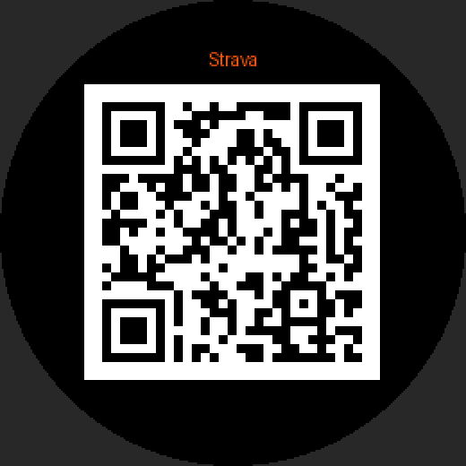

# StatCard — share your Strava and show your stats on a Garmin watch

A Connect IQ watch app. Open it, hold the watch up, and the other person points
their phone camera at it:

| Page | What it shows |
|---|---|
| 1. **Strava** | QR code of your Strava profile link. Their camera opens it and they can follow you. |
| 2. **Stats** | Steps today, distance over 7 days, active minutes this week, resting HR, VO2 max, last activity. |

Tap the screen (or press START), swipe, or use UP/DOWN to change pages. BACK exits.



## Why a QR code and not NFC "tap"

Garmin watches have NFC, but it is reserved for Garmin Pay. Connect IQ apps
can't use it, and Garmin's Bluetooth API can't push data to a stranger's phone
either. A QR code works with any phone camera (iPhone or Android) and needs no app on their side.

## Build and install (sideload)

1. Install [VS Code](https://code.visualstudio.com/) and the **Monkey C** extension (by Garmin).
2. Run **Monkey C: Verify Installation**. It installs the Connect IQ SDK Manager. Sign in
   and download the latest SDK and your watch's device files.
3. Run **Monkey C: Generate a Developer Key** (the extension stores the key for you).
4. Put your link and name in `resources/settings/properties.xml`:
   ```xml
   <property id="stravaUrl" type="string">https://www.strava.com/athletes/12345678</property>
   <property id="displayName" type="string">Sam</property>
   ```
   Find your link in Strava: open your profile, tap Share, then copy the link. Or copy the
   URL of your profile page on strava.com. Any URL works here, Instagram included.
5. Open this `garmin-statcard` folder in VS Code and run **Monkey C: Build for Device**.
   Pick your watch. It writes a `.prg` file.
6. Plug the watch in over USB and copy the `.prg` into `GARMIN/APPS/`. On a Mac, use
   [OpenMTP](https://openmtp.ganeshrvel.com/) for newer watches. Unplug, and **StatCard**
   appears in the watch's app list.

You can try it first with **Monkey C: Run** (the simulator). In the simulator,
*File → Edit Persistent Storage → Edit Application.Properties data* sets the link.

Command-line equivalent:
```sh
monkeyc -d fenix7 -f monkey.jungle -o bin/StatCard.prg -y /path/to/developer_key.der
```

### Your watch isn't listed?

`manifest.xml` lists common Fenix, Epix, Forerunner, Venu, Vivoactive and Enduro models.
To add yours, run **Monkey C: Edit Products** and tick your watch. If the build reports
an unknown device ID, remove that entry.

### Editing settings from the phone

A sideloaded app can't be configured from the Garmin Connect phone app. To change the
link, edit `properties.xml` and rebuild. If you upload the app to the Connect IQ Store,
even as a private beta, the link and name can be changed from the phone (*Garmin Connect → Device → Connect IQ Apps → StatCard → Settings*).

## Notes

- Which stats appear depends on what your watch exposes to apps. Missing stats are hidden.
  Units follow the watch's metric or statute setting.
- The screen backlight turns on when you open the app or change page, which makes scanning easier.

## Tests

`source/QrCode.mc` is a QR encoder written in plain Monkey C (byte mode, level L,
versions 1–6). It sticks to a subset of the language that also runs as JavaScript, so the
test runs **that same file** under Node and decodes every symbol with an independent
decoder ([jsQR](https://github.com/cozmo/jsQR)). The test covers every length from 1 to 134 bytes.

```sh
cd tools && npm install && npm test
```
